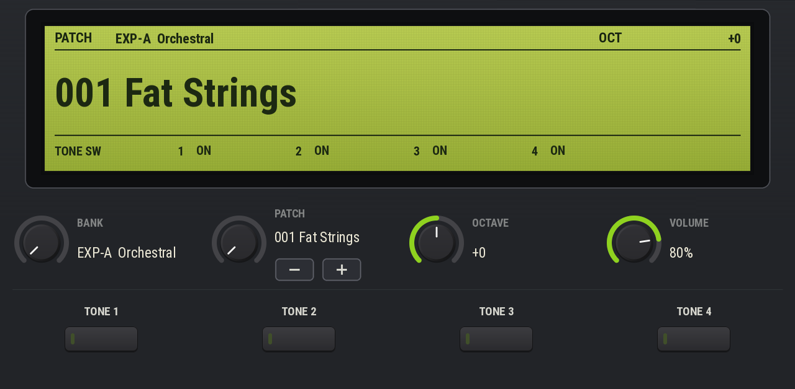
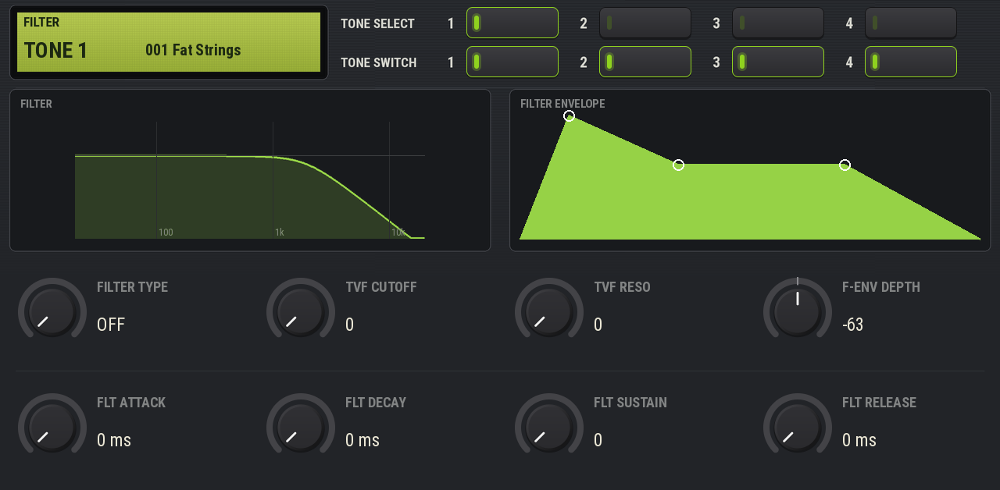

# XP-08

An **XP-80 style PCM synthesizer** for Akai MPC standalone hardware, built with the MPC Plugin
SDK. It plays the **Roland SR-JV80 expansion boards** from their dumps (their waves and their own
patches) on an engine that follows the XP-80's architecture (the JV-1080 generation's). With the
dumps of a JV-1080 and a JV-880, the tones on those instruments' built-in waves play too.

- four board slots and four patch banks, as on the XP-80; the boards shown by their official names
- the full XP-80 tone engine: four tones per patch, each with its wave, pitch envelope, filter
  (TVF), amplifier (TVA), two LFOs and a modulation matrix
- all 40 EFX types with all their parameters, plus chorus and reverb
- a filter in three models: the XP-80's own 12 dB filter, a steeper 24 dB, and a 4-pole LADDER
  with resonance to self-oscillation and drive
- touch pages for everyday editing (ADSR envelope graphs, a filter response picture) and pages
  with every XP-80 parameter; edits are heard at once and saved with the project

No Roland code or data is in this project. You bring the dumps of boards and instruments you own.

| | |
|---|---|
|  |  |

(Previews drawn by `tools/make_skin.py`, with sample values; on the MPC the text is the MPC's own.)

---

## Contents

- [Requirements and installation](#requirements-and-installation)
- [The ROM files](#the-rom-files)
- [The sound engine](#the-sound-engine)
- [The pages](#the-pages)
- [Editing, saving and MIDI](#editing-saving-and-midi)
- [CPU and memory](#cpu-and-memory)
- [Limitations and approximations](#limitations-and-approximations)
- [How the formats were worked out](#how-the-formats-were-worked-out)
- [Checked on real boards](#checked-on-real-boards)
- [Building and testing](#building-and-testing)
- [Sources and licences](#sources-and-licences)

---

## Requirements and installation

- An MPC standalone running **MPC OS 3.10.1 or later** (MPC Live / Live II / Live III, One / One+,
  X / X SE, Key 37 / 61, Force, XL), with **Preferences → Enhancements (Beta) → Enable
  Enhancements and External Plugin Support** turned on.
- The ROM dumps described below, from boards and instruments you own.

To install, copy the plugin folder, with your dumps in its `roms/` folder, into a folder named
`VST2 Plugins` on an MPC drive (internal storage, SD card or USB drive):

```
VST2 Plugins/
  Stephane Schmitz - VST - XP-08/
    plugin.json
    version.xml
    VST/            xp-08-arm32.so, xp-08-arm64.so
    Plugin Skins/   the touch pages
    roms/           your dumps (see below)
```

Then load **XP-08** on a track as an instrument plug-in. The boards load in the background a
second or two after the plug-in opens (the screen shows "loading..." until then).

To update the plug-in, replace its `VST/` and `Plugin Skins/` folders (or the whole folder, keeping
`roms/`).

---

## The ROM files

All the ROM files go in the plug-in folder's **`roms/`** folder. The plug-in recognises every file
**by its contents**, not by its name, and lists the boards it finds on the SLOTS page.

### Summary

| What | Files | Required? | What it gives |
|---|---|---|---|
| SR-JV80 expansion boards | one dump per board | **yes, at least one** | the boards' waves and patches: the banks EXP-A … EXP-D |
| JV-1080 internal waves | 5 files: program ROM + 4 wave ROMs | optional, strongly recommended | the INT-A / INT-B waves that about 2,200 tones of the boards 06–19 and Experience II–III use |
| JV-80 internal waves (from a JV-880) | 3 files: program ROM + 2 wave ROMs | optional, strongly recommended | the JV-80 waves that about 390 tones of the boards 01–05 and Experience I use |

Without the optional sets the boards play, but the tones on those built-in waves are silent: many
patches then sound thin or empty.

### 1. The SR-JV80 boards (required)

| | |
|---|---|
| Files | one per board, **any file name** |
| Size | 8 MB (the Experience boards: 2 MB) |
| Format | dumps straight from a board reader (scrambled) or already descrambled images: both work |
| How many | up to 32 are listed; four are loaded at a time (slots A–D) |

The plug-in shows each board by its official name, read from the code in the board's header:

| Board | Name shown | Patches |
|---|---|---|
| SR-JV80-01 | Pop | JV-80 |
| SR-JV80-02 | Orchestral | JV-80 |
| SR-JV80-03 | Piano | JV-80 |
| SR-JV80-04 | Vintage Synth | JV-80 |
| SR-JV80-05 | World | JV-80 |
| SR-JV80-06 | Dance | JV-1080 |
| SR-JV80-07 | Super Sound Set | JV-1080 |
| SR-JV80-08 | Keys of 60s & 70s | JV-1080 |
| SR-JV80-09 | Session | JV-1080 |
| SR-JV80-10 | Bass & Drum | JV-1080 |
| SR-JV80-13 | Vocal | JV-1080 |
| SR-JV80-14 | Asia | JV-1080 |
| SR-JV80-15 | Special FX | JV-1080 |
| SR-JV80-16 | Orchestral II | JV-1080 |
| SR-JV80-17 | Country | JV-1080 |
| SR-JV80-18 | Latin | JV-1080 |
| SR-JV80-19 | House | JV-1080 |
| SR-JV80-97 / 98 / 99 | Experience III / II / Experience | JV-1080 / JV-1080 / JV-80 |

Other boards (SR-JV80-11 Techno, 12 Hip-Hop, custom boards) are named from their file name, without
the `SR-JV80-nn` prefix and the checksum suffix: `SR-JV80-11 Techno - CS 0x1234.bin` shows as
"Techno".

The boards made for the JV-80 (01–05, Experience) carry only JV-80 patches; the plug-in converts
them to the JV-1080 layout when the board loads.

### 2. The JV-1080 internal waves (optional)

The patches of the boards 06–19 and Experience II–III use the JV-1080's built-in waves as well as
the board's (the XP-50 / 60 / 80 and the JV-1080 have the same 448 waves: INT-A 1–255, INT-B
1–193). They come from the **dumps of a JV-1080's chips**:

| File (example name) | Size | What it is |
|---|---|---|
| `jv1080_prom.bin` | 1 MB | the program ROM: the wave lists and the multisample and sample tables; also the EFX screens, which the plug-in's EFX parameter list was read from |
| `jv1080_waverom1.bin` | 2 MB | INT-A wave ROM, chip 1 |
| `jv1080_waverom2.bin` | 2 MB | INT-A wave ROM, chip 2 |
| `jv1080_waverom3.bin` | 2 MB | INT-A wave ROM, chip 3 |
| `jv1080_waverom4.bin` | 2 MB | INT-B wave ROM |

- **All five are needed.** The program ROM is essential: without it the four wave ROMs cannot be
  used.
- The file names are free, but **the three INT-A chips are taken in file-name order**: name them so
  that they sort as chip 1, 2, 3 (as above).
- The wave ROMs are recognised by their id (`RolandJV1080 … Intwave Ver1,00A`, `…B` for INT-B),
  the program ROM by its tables.

### 3. The JV-80 internal waves, from a JV-880 (optional)

The patches of the boards 01–05 and Experience I use the JV-80's built-in waves. The **JV-880** has
the same 129 waves:

| File (example name) | Size | What it is |
|---|---|---|
| `jv880_rom2_1.0.1.bin` | 256 KB | the program ROM ("rom2"): the multisample and sample tables |
| `jv880_waverom1.bin` | 2 MB | wave ROM, chip 1 |
| `jv880_waverom2.bin` | 2 MB | wave ROM, chip 2 |

- **All three are needed.** If there are two program ROM versions (`…1.0.0`, `…1.0.1`), the one whose
  file name sorts last is used.
- The two wave ROMs are taken in file-name order.
- Not needed (they can be deleted): the JV-880's CPU ROM (`jv880_rom1.bin`, 32 KB) and any
  `…descrambled….wav` exports of its waves.

### What the plug-in does not read

Any other file in `roms/` is ignored: READMEs, PCM card dumps, JD-990 data, other instruments'
ROMs.

### Legal

**Board and ROM dumps are Roland's data.** Use only dumps of boards and instruments you own, and
**never share a plug-in folder with dumps in it** (`tools/build.py --no-roms` builds a folder
without them). Roland, XP-80, JV-80, JV-880, JV-1080 and SR-JV80 are trademarks of Roland
Corporation; this plug-in is not affiliated with Roland.

---

## The sound engine

### Boards, banks and patches

As on the XP-80: **four slots, A–D**, each holding a board, and four patch banks, **EXP-A …
EXP-D**, each the patch table of the board in its slot (up to 256 patches). A tone can use the
waves of the board in any slot, or the internal waves.

### A patch: four tones

Each of the four tones is:

- **WG (wave generator):** a multisample (key zones, 32 kHz, forward / ping-pong / one-shot loops)
  from a board, INT-A / INT-B (JV-1080) or the JV-80 waves; coarse and fine tune, pitch keyfollow,
  random pitch; a four-stage **pitch envelope** with velocity and time keyfollow
- **TVF (filter):** LPF / BPF / HPF / PKG, cutoff with keyfollow, resonance; a four-stage
  **filter envelope** with depth, velocity curve and sensitivity, time keyfollow
- **TVA (amplifier):** level, wave gain, bias (level by key), velocity curve and sensitivity; a
  four-stage **amp envelope**; pan, pan keyfollow, random and alternate pan
- **two LFOs** (triangle, sine, saw, square, trapezoid, sample & hold, random, chaos) with rate,
  offset, key sync, delay, fade in / out, and depths to pitch, filter, level and pan
- **matrix control:** three controllers (the modulation lever and two assignable sources), four
  destinations each
- **key and velocity ranges** with velocity crossfade; tone delay (NORMAL, HOLD, CLOCK-SYNC to
  the patch's tempo, KEY-OFF); hold, bend, volume and pan switches; output to MIX or EFX with
  chorus and reverb sends

**Patch common:** level, pan, octave, bend range, solo / legato, portamento, velocity range switch,
the matrix controllers' sources, tempo.

**Polyphony** counts tones, as on the XP-80: a four-tone patch takes four voices per note. *Voices*
(SETUP) sets it, 8–64, 32 by default.

### The filter models

*Filter Model* (SETUP, or PRO 1 → TVF) applies to every patch:

| Model | |
|---|---|
| **XP-80 12dB** (default) | the original's 2-pole filter, 12 dB / octave: patches sound as programmed |
| **24dB** | the same through a second stage: twice as steep, for LPF, BPF and HPF |
| **LADDER** | a 4-pole 24 dB low-pass in the style of the classic analogue ladders: resonance that bites and thins the bass as it rises, self-oscillating at 127; its feedback saturates. BPF / HPF / PKG use the 24dB model |

*Filter Drive* (0–127) saturates the sound into the filter, in every model.

### Effects

As on the XP-80: an **EFX** (insert effect) for the tones sent to it, then **chorus** and
**reverb** (send effects). The patch's settings recall all three.

The EFX has all **40 types**, each with **all its parameters** (up to 12), named and shown in their
units as on the JV-1080's own screens:

| Family | Types |
|---|---|
| EQ and dynamics | STEREO-EQ, SPECTRUM, ENHANCER, COMPRESSOR, LIMITER |
| Drive and filter | OVERDRIVE, DISTORTION (with amp types), PHASER, AUTO-WAH |
| Modulation | ROTARY, HEXA-CHORUS, TREMOLO-CHORUS, SPACE-D, STEREO-CHORUS, STEREO-FLANGER, STEP-FLANGER |
| Delay | STEREO-DELAY, MODULATION-DELAY, TRIPLE-TAP-DELAY, QUADRUPLE-TAP-DELAY (taps in ms or note values at the patch's tempo), TIME-CONTROL-DELAY |
| Pitch | 2VOICE-PITCH-SHIFTER, FBK-PITCH-SHIFTER |
| Reverb | REVERB, GATE-REVERB (NORMAL, REVERSE, SWEEP1, SWEEP2) |
| Two-stage | OVERDRIVE / DISTORTION / ENHANCER → CHORUS / FLANGER / DELAY, CHORUS → DELAY, FLANGER → DELAY, CHORUS → FLANGER (in series), CHORUS / DELAY, FLANGER / DELAY, CHORUS / FLANGER (in parallel) |

Only the tones whose output is set to **EFX** go through it (EFX page: *Tone 1–4 > EFX*). The
patches of the boards made for the JV-80 send none: the JV-80 has no EFX. Picking a new type on
EFX EDIT loads that type's initial settings.

---

## The pages

Five function keys; press a key again for its next page.

| Key | Page | Controls |
|---|---|---|
| **PLAY** | PLAY | the screen (bank and board, patch, octave, tone switches); Bank, Patch (with − / +), Octave, Volume; TONE 1–4 |
| | SLOTS | the board in each slot, A–D |
| | SETUP | quick Cutoff / Resonance / Attack / Release on top of every patch; Prog Change, Voices; Filter Model, Filter Drive |
| **TONE** | WAVE | wave group and wave (with − / +), level, pan, coarse and fine tune, key range, velocity range and crossfade, wave gain |
| | FILTER | the filter's response for its type and cutoff; filter type, cutoff, resonance, envelope depth; the **filter envelope as an ADSR graph** with its four knobs |
| | AMP | the **amp envelope as an ADSR graph**; attack, decay, sustain, release; level, velocity sensitivity, velocity curve, pan |
| | LFO | both LFOs: wave, rate, depths to pitch, filter and amp, delays |
| **FX** | EFX | EFX type, output level, sends to chorus and reverb; each tone's output (MIX / EFX); EFX, chorus and reverb on / off |
| | EFX EDIT | the type's twelve parameters, each knob named for the type; type and output level |
| | CHO/REV | chorus (level, rate, depth, pre-delay, feedback, output) and reverb (type, level, time, HF damp, delay feedback) |
| **PRO 1** | COMMON | patch level, pan, octave, velocity range switch, bend range, solo / legato, portamento, controller sources |
| | WG, PITCH, P-ENV | every wave and pitch parameter; the pitch envelope's T1–T4, L1–L4 |
| | TVF, F-ENV | every filter parameter; the filter envelope's T1–T4, L1–L4 |
| | TVA, A-ENV | every amplifier parameter; the amp envelope's T1–T4, L1–L3 |
| **PRO 2** | PAN/OUT | pan, pan keyfollow, random and alternate pan; output, output level, chorus and reverb sends |
| | LFO1, LFO2 | every LFO parameter |
| | CTRL1–3 | the modulation matrix: four destinations and depths per controller |

**The tone strip.** Every tone page has, on top, a small screen with the tone being edited and the
patch, **TONE SELECT 1–4** (which tone the page edits) and **TONE SWITCH 1–4** (tones on / off), as
on the XP-80's panel.

**The ADSR graphs** are views of the XP-80's four-stage envelopes: Attack is T1, Decay moves T2 and
T3 together (keeping their ratio), Sustain is L3, Release is T4. A patch sounds as programmed until
one of them is turned, and the PRO pages keep every T and L value. The graphs can be dragged on the
touch screen.

**The filter picture** follows the filter type and the cutoff (in steps of four), drawn at a
moderate resonance and for the XP-80 model's slope.

**Q-Links:** on each page the hardware knobs control the page's knobs, in blocks of four.

---

## Editing, saving and MIDI

**Editing**, as on the XP-80: the patch you pick is copied into an edit buffer, and that is what
plays, so every change is heard at once. An edited patch shows `*` after its name on the screen.
Picking another patch drops the edit (as the XP-80 does without WRITE); **a project saves the
edited patch with it**, and the slots by file name.

**Patch selection:** the Patch knob, its − / + buttons (the knobs and the data wheel move a
256-value parameter in steps of about two; SHIFT + data wheel moves by one), or MIDI program
changes (they pick the patch in the current bank; *Prog Change* on SETUP turns that off).

**MIDI:** notes and velocity, pitch bend, the modulation lever (CC1, matrix controller 1), channel
aftertouch, CC2 / 4 / 7 / 10 / 11 as the patches' control sources ask, volume (CC7) and expression
(CC11) on tones with the volume switch, hold (CC64), all notes / sound off, reset controllers.

---

## CPU and memory

**CPU.** The MPC's processor is the limit. On a desktop computer, 32 voices take about 1.3 % of one
core; expect roughly ten times that share of one MPC core. Per voice, the 24dB filter costs about
16 % more and the LADDER about 60 % more than the XP-80 filter. Lower *Voices* (SETUP) if the MPC
struggles.

**Memory.** Each loaded board takes about 16 MB (its waves decoded), the JV-1080 waves about 16 MB,
the JV-880 waves about 8 MB. The same board in two slots is loaded once.

---

## Limitations and approximations

**Not there:**

- **WRITE / a user bank:** edits are kept in the project only.
- **Rhythm sets** (the boards' drum kits play from their patches on the drum keys), the XP-80's
  **Performance mode** (16 parts) and its own **preset banks**; the JV-1080's preset patches.
- **PCM card waves** (tones on an SR-JV80 PCM card play without that tone) and the **JD-990 patch
  tables** (SR-JV80-04 and custom boards carry one; a board with only JD-990 patches, such as a
  custom board, has an empty bank).
- **Tone structures 2–10** (filter chaining, ring modulation, booster) play as structure 1;
  **FXM**, **analog feel** and **stretch tuning** are not modelled; tone delay PLAYMATE plays as
  NORMAL and TAP-SYNC follows the patch's tempo; matrix destinations 6–8 are not modelled.
- **The EFX controllers** (two sources that move two parameters of each EFX type, such as the
  rotary's speed) are not implemented yet.
- From the JV-80 patches: **level keyfollow** and the **resonance mode** are not converted.

**Approximations** (measured on the boards' data where possible, not on the hardware):

- **Envelope times, LFO rates and depths, cutoff in hertz:** fitted curves. The envelope times
  follow what the patches need (a pizzicato's decay, a tempo patch's drum hit length).
- **Pitch LFO depth:** about 3 cents a step for the small depths used for vibrato and drift,
  rising to an octave at 63.
- **The JV-80 patches' cutoffs** are converted to the JV-1080's scale (the same number is a brighter
  filter on a JV-80) with a curve fitted on the two families' patches.
- **The EFX:** the parameters, their order, units, lists and the time and rate scales come from the
  JV-1080's program ROM; how far some of them reach is this plug-in's choice: chorus / flanger /
  phaser / wah depths, drive gains and amp types, the phaser's manual (100 Hz – 8 kHz), the gate
  time (5–500 ms), the spectrum's bands (250 Hz – 8 kHz), the rotary's crossover and doppler, the
  compressor's curve, the limiter's threshold (−60 – 0 dB; a few patches pairing a high threshold
  with a large post gain come out loud), the pitch shifters' window per mode (15–80 ms; a two-tap
  shifter, with sidebands around the new pitch on pure tones), the tap delays' top ten steps read
  as note values (1/16 … 1/2).
- **SYS-CTRL1 / SYS-CTRL2** (patch control sources) are read as aftertouch and the foot controller
  (CC4); on the XP-80 they follow the system settings.
- **The screen** is drawn by the MPC in its own fonts, not as the XP-80's dot-matrix display. The
  page follows a MIDI program change when the MPC next redraws it.

---

## How the formats were worked out

- **SR-JV80 boards:** the community's descriptions (see Sources) of the address and data line
  scrambling, the DPCM wave coding, the block headers, the sample and multisample tables and the
  JV-1080 patch records. The boards' value encodings were then measured on about 3,800 patches:
  signed parameters are stored from 0 (±63 as 0–126, coarse tune 0–96, fine 0–100, velocity
  sensitivities 0–125); the sample fine-tune field is the correction to apply on playback; the
  matrix has 19 destinations; ping-pong loops run backwards reversed and inverted (as DPCM hardware
  does), which is why the boards cut them at zero crossings.
- **JV-80 patch records:** the JV-880 manual's parameter map, as bit fields.
- **JV-1080 internal waves:** worked out here from the dumps. The wave chips use the boards' block
  layout and DPCM coding, the boards' data-line order and an address-line order of their own,
  found from the data (neighbouring samples correlate: each address bit's partner is the one that
  puts correlated bytes next to each other); the program ROM holds the tables in the boards' 60- and
  18-byte formats and a wave list per group.
- **JV-880 internal waves:** wired as the boards are; checked against the waves decoded by other
  means, sample for sample.
- **EFX parameters:** the JV-1080's own EFX edit screens, in its program ROM: for each type, which
  of the patch's twelve values each parameter is, its display format and list or scale. The time
  and rate scales are the firmware's tables, reduced to their rules; no ROM data is copied into the
  plug-in.
- **Tone delay modes:** all seven occur on the boards (NORMAL, HOLD, PLAYMATE, CLOCK-SYNC,
  TAP-SYNC, KEY-OFF-NORMAL, KEY-OFF-DECAY); CLOCK-SYNC times are clock ticks, 24 a quarter note, at
  the patch's tempo.

---

## Checked on real boards

`tests/run.sh` plays every patch of every dump it finds in `roms/` (or in the built plug-in's
`roms/`). On 21 boards (SR-JV80-01 to 19, 97, 98, 99) with the JV-1080 and JV-880 sets:

- every board loads (names, dates, samples, multisamples, JV-1080 tables, JV-80 tables converted);
- **no tone points at a wave that is not there**;
- **4,071 of 4,176 patches sound at C4** in the test's half second; the rest are drum kits (they
  play on the drum keys), slow pads and tempo patches that start later;
- tuning: the samples' pitch matches their root keys within a median of 0–2 cents on the boards,
  +1.6 cents on the JV-1080 waves, +0.9 cents on the JV-880 waves; patches play A4 at 440 Hz;
- every patch played for three seconds through its own EFX: none runs away.

---

## Building and testing

```sh
python3 tools/build.py            # native build, skin, arm32 + arm64, validator, roms/
tests/run.sh                      # the tests (after a build)
```

`tools/build.py` uses the MPC Plugin SDK (in `../mpc-plugin-builder-sdk`, or `$SDK`) and, for the
touch pages, Python 3 with Pillow (`pip install pillow`). It copies
the dumps in this project's `roms/` into the output's `roms/` (`--no-roms` to leave them out). The
output is `build/Stephane Schmitz - VST - XP-08/`.

The tests:

- **`tests/card_test.cpp`** (72 checks) builds its own SR-JV80 board, JV-1080 and JV-880 style ROM
  sets (no Roland data), scrambled as the chips are, and checks the readers (patches bit for bit,
  waves within 50 dB of their source), the engine (pitch, zones, loops and their wraps, ping-pong,
  releases, tone delays, LFO rates live, the three filter models' slopes and resonance) and the
  effects (delay times, CROSS feedback, tempo-synced taps, reverb, drive, pitch shifter, EQ,
  compressor, rotary…).
- **`tests/plugin_test.cpp`** (26 checks) runs the native plug-in through the VST2 interface at
  real-time pace: the board loads in the background, patches change from the knob, the − / +
  buttons and MIDI program changes, the edit pages follow the selected tone, edits play and are
  saved with the project, the EFX pages follow the type, the ADSR views write the envelopes.
- **The SDK's host simulator:** 18 checks pass. Its one warning (silence) is expected: it renders
  its two seconds before the board has loaded.
- **`tests/inspect.cpp`** plays every patch of the dumps in `roms/` and reports per board.

Source layout:

| File | |
|---|---|
| `src/XP08.cpp` | the plug-in: parameters, edit buffer, loader thread, state |
| `src/srjv.h/.cpp` | the readers: SR-JV80 boards, JV-1080 and JV-880 internal ROMs |
| `src/engine.h/.cpp` | the tone engine: voices, envelopes, LFOs, filters, matrix |
| `src/fx.h/.cpp` | EFX (all 40 types), chorus, reverb |
| `src/jvparams.h` | the patch parameter map and tables |
| `src/editparams.h` | the edit parameters (one row each) |
| `src/efxdefs.h` | the 40 EFX types' parameters, lists and scales |
| `tools/make_skin.py` | draws the touch pages (`skins/`, previews in `preview/`) |

---

## Sources and licences

- This plug-in: MIT (`LICENSE`). The MPC Plugin SDK framework compiled in: MIT.
- The SR-JV80 format, as described by the community; this is an independent implementation of
  those descriptions:
  - [hackyourlife/srscramble](https://github.com/hackyourlife/srscramble): the scrambling of
    address and data lines, and the ID block,
  - [giulioz's decoder gist](https://gist.github.com/giulioz/39e96282371ffb5059e112f6281efa60):
    the descrambling permutation and the DPCM wave decoding,
  - [PythonBlue/SRJV](https://github.com/PythonBlue/SRJV) (`FORMAT.md`, `Import2080.py`): the
    block headers, the sample and multisample tables, the loop types and the bit-packed JV-2080
    patch records.
- The patch parameter map follows the JV-1080 / JV-2080 MIDI implementation; the JV-80 records the
  JV-880 owner's manual.
- The JV-1080 and JV-880 internal ROMs and the EFX parameter screens: worked out here from dumps.
- Roland, XP-80, JV-80, JV-880, JV-1080 and SR-JV80 are trademarks of Roland Corporation; this
  plug-in is not affiliated with Roland. The ROM dumps are Roland's data and are not part of it.
